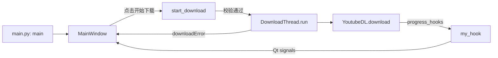

# 代码说明

开发 Version-2 时，从 [`Version-2/main.py`](Version-2/main.py) 开始阅读；启动和打包命令见 [README](README.md#version-2-从源码启动)。项目是本地桌面应用，无需启动后端服务或数据库。

## 1. 目录与版本关系

| 位置 | 职责 |
|---|---|
| [`src/`](src/) | tkinter 最新稳定源码：Windows 1.12.1、macOS 1.12.2，共用输入校验模块 |
| [`Version-2/`](Version-2/) | PySide6 alpha 重写，入口、窗口、下载线程和设置对话框分开存放 |
| [`tests/`](tests/) | 标准库 `unittest` 回归测试，不依赖安装 Qt 或真实下载 |
| [`archive/`](archive/) | 历史源码、旧界面原型及闲置资源；迁移清单见 [`archive/README.md`](archive/README.md) |
| [`archive/Releases/`](archive/Releases/) | 1.1 历史打包产物，保留完整分发目录 |

稳定版与 Version-2 是两个独立 GUI。Version-2 仍为 alpha，尚未发布为 2.0。整理时本地最高 Git tag 为 `v1.9.0`，不能据此判断最新源码版本。Version-2 没有调用稳定版下载类，也没有复用 `src/validation.py`；修改一个版本不会自动改变另一个版本。

## 2. Version-2 模块职责

| 文件 | 关键符号 | 负责什么 |
|---|---|---|
| [`main.py`](Version-2/main.py) | `main()` | 创建 `QApplication`、显示 `MainWindow`、进入 Qt 事件循环 |
| [`mainwindow.py`](Version-2/mainwindow.py) | `MainWindow`、`_is_valid_http_url()` | 构建界面、读取默认设置、校验输入、创建下载任务、更新任务表格 |
| [`downloader.py`](Version-2/downloader.py) | `find_ffmpeg_location()`、`DownloadThread` | 查找 FFmpeg、配置 yt-dlp、在 `QThread` 中下载并发送进度信号 |
| [`settingsdialog.py`](Version-2/settingsdialog.py) | `SettingsDialog` | 编辑和保存偏好设置 |

早期界面原型已移至 [`archive/Version-2/test.py`](archive/Version-2/test.py)，其中独立的 `MainWindow` 只向表格添加示例行，不属于当前运行链路或自动化测试。

### 启动与下载流程



1. `main()` 创建 Qt 应用和窗口；`MainWindow.__init__()` 读取 `QSettings`、连接按钮事件及剪贴板事件。
2. `start_download()` 检查 HTTP(S) URL、已有且可写的下载目录，以及 FFmpeg 路径。失败时更新状态栏并返回，不新增任务行。
3. 校验通过后，窗口新增表格行，创建 `DownloadThread`，连接三个信号，并将线程保存在 `download_threads[row]` 中。
4. `DownloadThread.run()` 构造 `ydl_opts`，调用 `YoutubeDL.download([video_url])`；网络与下载工作在后台线程执行。
5. `my_hook()` 发出进度或完成信号；异常通过 `downloadError` 发出。窗口的 `update_task()`、`finish_task()`、`error_task()` 更新对应行与状态栏。

### 下载参数

| 参数或选项 | 当前实现 |
|---|---|
| 文件名 | `%(title)s.%(ext)s`；表格中的 `视频_<随机 ID>` 只是临时显示名 |
| 分辨率 | `720p`、`1080p` 使用 `bv[height=高度]+ba/best`；`4K` 和 `原画` 都走 `bestvideo+bestaudio/best`，没有单独限制 2160p |
| 字幕 | 中文映射 `zh`，英文映射 `en`；使用 `writesubtitles` 并转换为 SRT，没有启用自动字幕下载 |
| 网络容错 | socket 超时 30 秒，下载重试 5 次，分片重试 5 次 |
| 其他 | `noplaylist=True`、`nooverwrites=True`；没有强制设置合并后的容器格式，也没有稳定版的 MP3 单独下载选项 |

### FFmpeg 查找与打包

`find_ffmpeg_location()` 按下列顺序查找 Windows 的 `ffmpeg.exe` 或其他平台的 `ffmpeg`：

1. `downloader.py` 所在目录。
2. 该目录的父目录下的 `src/`。
3. `sys.executable` 所在目录（源码运行时通常是 Python 目录，打包后是应用程序目录）。
4. PyInstaller 的 `sys._MEIPASS` 资源目录（如果存在）。
5. 系统 `PATH`，通过 `shutil.which()` 查找。

前四项只检查文件是否存在，不验证文件内容、执行权限或 CPU 架构。因此 Git LFS 指针文件和不兼容的二进制文件也可能被选中；开发前应执行 README 中的 `-version` 检查。

返回值传给 `DownloadThread`，再写入 yt-dlp 的 `ffmpeg_location`。打包命令同时收集 `ffmpeg` 和 `ffprobe`；程序本身只显式查找前者。PyInstaller 中 `__file__`、`sys.executable` 和 `_MEIPASS` 的区别见[运行时路径说明](https://pyinstaller.org/en/stable/runtime-information.html)。

### 偏好设置

窗口和设置对话框均使用 `QSettings("MyCompany", "YtdlpGUI")`，由 Qt 保存到平台配置存储，不写入仓库中的 JSON 文件。

| 配置键 | 默认值 | 当前生效情况 |
|---|---|---|
| `defaultDownloadPath` | 空字符串 | 启动及保存设置后填入下载目录 |
| `defaultResolution` | `1080p` | 启动及保存设置后更新分辨率选项 |
| `defaultSubtitle` | `中文` | 主窗口只接受中文、英文、无字幕；设置中的“自动检测”无法匹配主窗口选项 |
| `clipboardMonitoring` | 字符串 `"true"` | 对话框会保存，主窗口未读取此开关；剪贴板监听始终连接 |
| `autoDownload` | 字符串 `"false"` | 对话框会保存，尚未连接自动下载行为 |

### alpha 阶段的行为边界

- 剪贴板变化只自动填入 HTTP(S) 链接，尚未解析视频信息，也不会自动开始下载。
- 分辨率与字幕列表是固定选项，没有稳定版的扫描功能。
- `downloadFinished` 在 yt-dlp 的下载进度 hook 收到 `finished` 时发出；后续合并、转换可能仍在进行，表格“已完成”不等于全部后处理结束。
- 每次点击都创建一个线程，目前没有任务取消、并发上限或关闭窗口时等待下载结束的处理，下载期间应保持窗口打开。

## 3. tkinter 稳定版

[`src/1.12.1_win.py`](src/1.12.1_win.py) 与 [`src/1.12.2_mac.py`](src/1.12.2_mac.py) 的核心都是 `YtdlpGUI`。入口创建 `ThemedTk`，实例化窗口后调用 `mainloop()`。

| 入口或方法 | 流程 |
|---|---|
| `start_scan_thread()` → `scan_formats()` | 校验 URL，后台调用 `extract_info(download=False)`，收集分辨率 |
| `start_sub_scan_thread()` → `scan_subtitles()` | 校验 URL 与字幕开关，扫描原生及自动字幕并筛选支持的语言 |
| `start_download_thread()` → `download_video()` | 主线程读取控件、校验 URL/目录，后台配置视频或 MP3 下载及字幕转换 |
| `_post_ui()` → `_process_ui_events()` | 后台把 UI 回调放入 `queue.Queue`，Tk 主线程每 50 毫秒处理一次 |
| [`validation.py`](src/validation.py) | `is_valid_http_url()` 校验协议与主机部分；`validate_output_dir()` 返回 `(是否有效, 错误文案)` |

稳定版 Windows 在脚本或启动程序同目录查找 `ffmpeg.exe`，并设置 `windowsfilenames=True`；macOS 目前写死 `/opt/homebrew/bin/ffmpeg`。这与 Version-2 的多路径查找不同。

`src/*.spec` 是稳定版专用 PyInstaller 配置。Windows spec 收集 FFmpeg，macOS spec 不收集 FFmpeg；不要把它们当作 Version-2 的构建配置。

## 4. 常见修改入口

| 要修改的内容 | 优先查看 |
|---|---|
| Version-2 窗口布局、输入校验、任务状态 | `Version-2/mainwindow.py` |
| 下载格式、字幕选项、重试与进度 | `Version-2/downloader.py`；稳定版则查看两个入口内的 `download_video()`、`my_hook()` |
| 默认值或新增偏好项 | `Version-2/settingsdialog.py`，并在 `mainwindow.py` 接入读取与实际行为 |
| FFmpeg 定位或打包后找不到文件 | `Version-2/downloader.py::find_ffmpeg_location()` 与 README 打包命令 |
| 稳定版共用的 URL、目录校验 | `src/validation.py` 与 `tests/test_validation.py` |

## 5. 验证方式

在仓库根目录运行：

```bash
python -m unittest discover -s tests -v
```

`tests/test_validation.py` 检查稳定版 URL、目录校验；`tests/test_version2_ffmpeg.py` 用替身模块加载下载器，检查仓库内 FFmpeg 能被找到，无需安装 Qt 或 yt-dlp。

这些测试不覆盖 GUI 操作、真实网络下载或分发包。修改对应逻辑后，应按 README 启动目标版本，检查输入、设置、下载进度和输出文件；打包后的资源定位要在仓库外额外验证。
